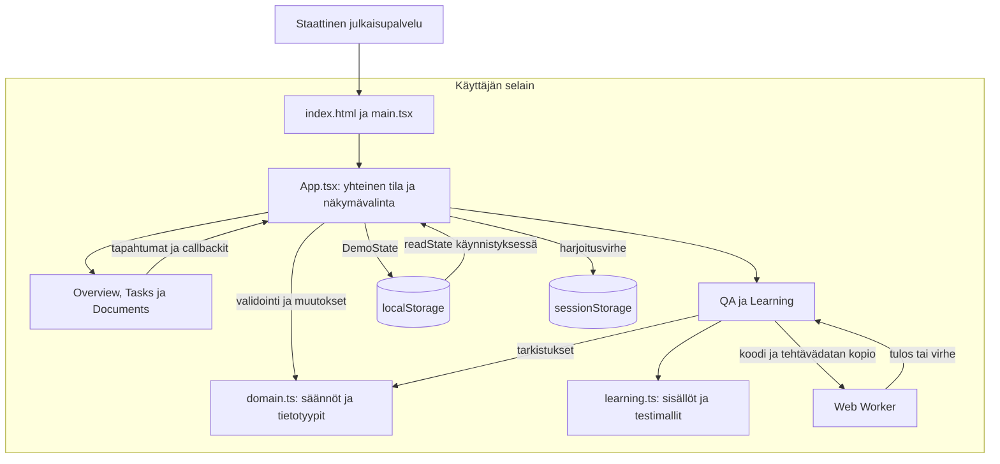
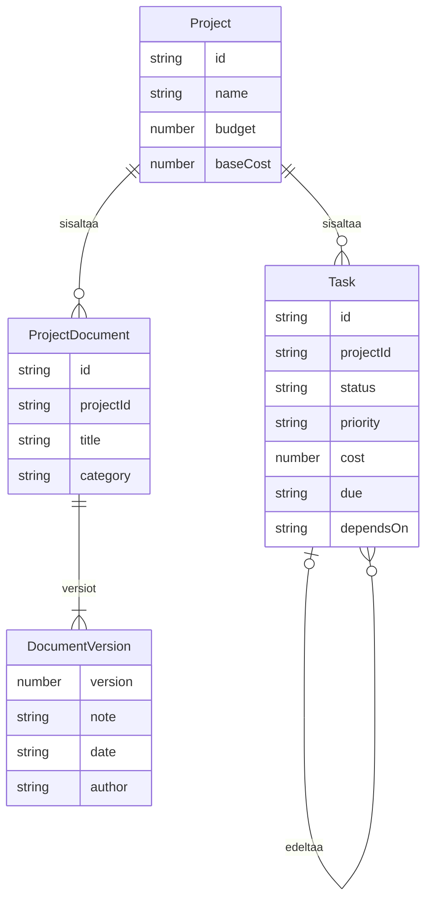

# Rakenna - arkkitehtuurikuvaus

Päiväys: 8.11.2026. Kohde: Rakenna - projektit & QA-labra, julkaistu versio 1.
Lähdeversio: `87143b7bea1b3badf96391f87b656842d2b45bf7`.

Kuvaus perustuu tarkistettuun julkaistuun lähdekoodiin. Erikseen tallennettujen `learning.ts`- ja `Learning.tsx`-harjoitustiedostojen erot käsitellään lopussa. Käyttäjän Windows-koneella olevaa koko projektia ei ole tässä tarkastettu.

## 1. Kokonaisratkaisu

Rakenna on selaimessa toimiva React/TypeScript-harjoitussovellus. Sama käyttöliittymä yhdistää kuvitteellisen rakennusprojektien hallinnan, ohjelmoinnin oppimispolun sekä QA-labran. Sovellus on yhden sivun sovellus eli SPA.

Liiketoimintatietojen käsittely tapahtuu selaimessa. Sovelluksella ei ole omaa backend-API:a, palvelintietokantaa tai tiedostopalvelua. Julkaisupalvelu jakaa staattiset HTML-, JavaScript- ja CSS-tiedostot ja rajaa yksityisen sivuston pääsyn. Sivuston kirjautumisraja on eri asia kuin sovelluksessa vaihdettava harjoitusrooli.



| Teknologia | Rooli tässä sovelluksessa |
| --- | --- |
| JavaScript | Selaimen suorittama ohjelmalogiikka; myös muokattava JS-harjoitus. |
| TypeScript | Tietomallit, komponenttien rajapinnat ja tyyppitarkistus. Tyypit poistuvat käännöksessä. |
| React ja TSX | Komponentit, tapahtumat, tilanhallinta ja käyttöliittymän renderöinti. |
| Vite | Paikallinen kehityspalvelin sekä tuotantotiedostojen muodostaminen. |
| Vitest ja Playwright | Funktioiden yksikkötestit sekä käyttäjän työnkulkujen selaintestit. |

`package.json` määrittelee React 19-, TypeScript 5.9- ja Vite 7 -päälinjat. Tarkat asennusversiot määräytyvät `package-lock.json`-tiedostosta. Sovellus ei käytä Reduxia eikä React Routeria: `App` vaihtaa näkyvää komponenttia `view`-tilan perusteella. Näkymävalinta ei päivity URL:iin.

## 2. Moduulit ja vastuut

| Tiedosto | Vastuu | Keskeinen yhteistyö |
| --- | --- | --- |
| `src/main.tsx` | Liittää Reactin HTML:n root-elementtiin ja lataa CSS:n. | Käynnistää `App`-komponentin `StrictMode`-tilassa. |
| `src/App.tsx` | Omistaa yhteisen `DemoState`-tilan, projektivalinnan, roolin ja harjoitusvirheen. | Välittää propsit näkymille ja käsittelee niiden callbackit. |
| `src/Overview.tsx` | Näyttää tehtävistä ja projektista johdetut mittarit. | Käyttää `budgetSummary`-laskentaa ja siirtää käyttäjän muihin näkymiin. |
| `src/Tasks.tsx` | Tehtävätaulu, haku, suodatus, tilavalinta ja `TaskDialog`-lomake. | Kutsuu `onStatus`, `onEdit` ja `onSave`; ei itse omista koko tehtäväkantaa. |
| `src/Documents.tsx` | Dokumenttikortit, harjoitusroolin valinta, versiohistoria ja `VersionDialog`. | Pyytää `App`-komponenttia lisäämään version. |
| `src/domain.ts` | Tietotyypit, demoaineisto, liiketoimintasäännöt, laskenta ja `readState`. | Muutosfunktiot palauttavat uuden datan; moduuli ei tuo Reactia. |
| `src/QA.tsx` | Testiluonnokset, arviointilista, virhesimulaatio ja tarkistusten tulokset. | Lukee `learning.ts`-malleja ja ajaa `runDomainChecks`-funktion. |
| `src/Learning.tsx` | Oppimispolku ja JavaScript-, TypeScript- sekä React-harjoitusten käyttöliittymät. | Lukee oppisisällöt ja välittää harjoittelumerkinnät `App`-komponentille. |
| `src/learning.ts` | Oppitunnit, JS-aloituskoodi, QA-tapausten mallit ja `makePrompt`. | Yhteinen sisältömoduuli sekä `Learning`- että `QA`-komponentille. |
| `src/ui.tsx`, `src/styles.css` | Jaetut dialogit, koodilohkot, avatarit, piirros ja ulkoasu. | Näkymät käyttävät samoja esityskomponentteja. |

Props kuljettaa dataa alaspäin. Callback kuljettaa käyttäjän muutosesityksen takaisin tilan omistajalle. Esimerkiksi tehtävätaulu näyttää `App`-komponentilta saamansa tehtävät, mutta tehtävän tilan vaihto kulkee `App.updateStatus`-funktion kautta `domain.changeTaskStatus`-funktioon.

Paikallinen käyttöliittymätila pysyy näkymissä: `Tasks` omistaa hakusanan ja suodattimet, `Documents` avatun versioikkunan ja `QA` valitun testitapauksen. Näkymästä poistuminen purkaa sen komponentin ja nollaa tämän paikallisen tilan. `Tasks` ja `Documents` saavat myös projektin vaihtumisen yhteydessä uuden React-avaimen.

## 3. Tietomalli ja tallennus



Kaavio kuvaa TypeScript-olioiden suhteita, ei toteutettuja tietokantatauluja. `dependsOn` on valinnainen: tehtävällä voi olla enintään yksi edeltäjä ja useita jatkotehtäviä. `DocumentVersion` on dokumentin sisäinen taulukko, eikä sillä ole omaa globaalia tunnistetta. Vastuuhenkilö ja version tekijä ovat merkkijonoja, eivät erilliseen käyttäjärekisteriin viittaavia tunnisteita.

| Tieto | Omistaja ja tallennus | Elinkaari |
| --- | --- | --- |
| Tehtävät, dokumenttiversiot, harjoittelumerkinnät | `App.state` eli `DemoState`; localStorage-avain `rakenna-qa-lab-v1`. | Säilyvät sivun latauksessa samassa selaimessa ja originissa. |
| Projektien perustiedot | `domain.ts`-moduulin `projects`-vakio. | Osa sovelluksen lähdekoodia; eivät kuulu tallennettavaan `DemoState`-olioon. |
| Harjoitusvirhe | `App.fault`; sessionStorage-avain `rakenna-fault`. | Säilyy latauksessa kyseisessä välilehti-istunnossa. |
| Valittu projekti, näkymä ja harjoitusrooli | `App`-komponentin erilliset React-tilat. | Palaavat latauksessa oletuksiin: p1, overview ja manager. |
| Haku, lomakkeet, testiluonnos ja tarkistusten tulokset | Näkymän omat React-tilat. | Säilyvät vain komponentin elinkaaren ajan. |

Käynnistyksessä `readState()` lukee JSON-datan. Se tarkistaa skeemaversion ja päätason taulukot; virheellinen tai puuttuva tallennus palauttaa `initialState()`-aineiston. Tarkistus ei ole syvä kenttäkohtainen skeemavalidointi.

`useEffect` tallentaa muuttuneen `DemoState`-olion kokonaisena JSON:na. Jos kirjoitus epäonnistuu, sovellus jatkaa muistissa ja kertoo tallennuksen puuttumisesta. Tallennus ei synkronoidu laitteiden tai eri osoitteiden välillä, eikä eri välilehtien muutoksille ole yhdistämislogiikkaa.

Harjoituksen päivä on koodissa `2026-11-07`. Se pitää myöhästymisten, versioiden päivämäärien ja testien esimerkit toistettavina.

## 4. Tiedonkulku ja liiketoimintasäännöt

Tehtävän tallennus etenee seuraavasti:

```mermaid
sequenceDiagram
  participant User as Käyttäjä
  participant Form as TaskDialog
  participant App as App
  participant Domain as domain.ts
  participant Store as localStorage
  User->>Form: Nimi, päivä, kustannus ja riippuvuus
  Form->>App: onSave(candidate)
  App->>Domain: saveTask(state.tasks, candidate)
  alt Syöte tai riippuvuus virheellinen
    Domain-->>Form: Poikkeus App-kutsun läpi
    Form-->>User: Virheilmoitus; lomake pysyy auki
  else Tallennus hyväksytään
    Domain-->>App: Uusi tehtävätaulukko
    App->>App: setState ja näkymän päivitys
    App-->>Form: Sulje lomake
    App->>Store: useEffect: JSON.stringify(state)
    Note over App,Store: Tallennusyritys voi epäonnistua erikseen
  end
```

| Funktio | Toteutettu sääntö |
| --- | --- |
| `validateTask` | Nimi ei saa olla tyhjä ja on enintään 120 merkkiä. Kustannuksen pitää olla äärellinen ja vähintään nolla. Päivän pitää olla oikea ISO-päivämäärä. |
| `saveTask` | Lisää tai korvaa tehtävän. Estää riippuvuuskehän ja toisen projektin edeltäjän sekä tarkistaa valmiin tehtävän riippuvuuden. |
| `changeTaskStatus` | Edeltäjän on oltava valmis ennen jatkotehtävää. Valmista edeltäjää ei avata uudelleen valmiin jatkotehtävän alta. |
| `addDocumentVersion` | Tavallisesti vain manager-rooli voi lisätä version. Muutoskuvaus on pakollinen; numero on aiempi maksimi + 1 ja historia säilyy. |
| `budgetSummary` | Sidottu arvio = projektin pohjakustannukset + saman projektin tehtävien kustannusarviot. Jäljellä = budjetti - sidottu arvio. |

Kustannuksen ylitys näytetään varoituksena; se ei estä tehtävän tallennusta. Budjettiluku ei kuvaa kirjanpidon toteutuneita maksuja. Dokumenttiversio tallentaa vain metatiedot, ei PDF-tiedoston sisältöä.

Muutosfunktiot palauttavat uuden taulukon tai olion ja jättävät alkuperäisen datan muuttumatta. Validointipoikkeus estää yhteisen tilan päivityksen. Onnistumisilmoitus tarkoittaa muistissa hyväksyttyä muutosta; pysyvä selaintallennus seuraa erillisessä effectissä.

## 5. QA-labra, tekoäly ja testaus

Julkaistun perusversion testauksessa on kolme eri tasoa:

| Taso | Toteutus ja aineisto | Mitä se osoittaa? |
| --- | --- | --- |
| QA-labran ajettavat tarkistukset | `runDomainChecks(fault)`, kuusi tarkistusta; jokaisessa ajossa uusi vakioaineisto. | Samojen liiketoimintafunktioiden odotetut tulokset ja harjoitusvirheen havaitseminen. Ei selaimen työnkulkua. |
| Vitest-yksikkötestit | `tests/unit/domain.test.ts`, 26 tapausta julkaistussa lähdeversiossa. | Sääntöjä ja rajatapauksia, kuten virheellisiä päiviä, riippuvuuskehää, roolia ja projektirajausta. |
| Playwright-E2E | `tests/e2e/project.spec.ts`, seitsemän testiä julkaistussa lähdeversiossa. | Käyttäjän toimet, DOM-tarkistukset, selaintallennuksen säilyminen ja projektien erottelu. |

Määrät kuvaavat tarkistetun lähdekoodiversion sisältöä, eivät tässä dokumentointityössä tehtyä uutta testiajoa. Käyttäjän omat lisätestit voivat kasvattaa määriä.

QA-labra käyttää samoja funktioita kuin käyttöliittymä, mutta ei käyttäjän muokkaamaa tehtävälistaa. Siksi lähtötilanteen 6/6-tulos säilyy riippumatta oman demon kustannusmuutoksista. `Fault` on eksplisiittinen parametri, jolla valittu toiminta muuttuu:

| Harjoitusvirhe | Muutettu toiminta | Odotettu labratulos |
| --- | --- | --- |
| `none` | Normaali toteutus. | 6/6 läpäisee. |
| `dependency` | `changeTaskStatus` ohittaa valmistumisen riippuvuustarkistuksen. | 5/6 läpäisee. |
| `version` | `addDocumentVersion` jättää versionumeron ennalleen. | 5/6 läpäisee. |
| `permission` | `addDocumentVersion` hyväksyy lukijaroolin. | 5/6 läpäisee. |

`App` omistaa virhevalinnan, joten se vaikuttaa sekä labraan että tehtävien tai dokumenttien toimintaan. Virheen poistaminen muuttaa tulevat toiminnot; jo tallennettu väärä demodata palautetaan erikseen palautustoiminnolla.

### AI-avusteisen työskentelyn raja

`learning.ts` sisältää valmiit testitapaukset sekä `makePrompt`-funktion. `QA.tsx` valitsee mallin ja näyttää suunnitelman, Playwright-koodin tai kopioitavan kehotteen. Lisäkonteksti liitetään kehotteeseen; se ei automaattisesti muokkaa mallikoodia. Sovellus ei kutsu LLM-API:a eikä käytä API-avainta. Käyttäjä kopioi kehotteen ulkoiseen AI-työkaluun ja arvioi tuotoksen itse. Testitiedoston lataaminen ei käynnistä Playwrightia selaimessa.

### JavaScript-harjoituksen suoritusrakenne

`JavaScriptPractice` luo Blob-lähteestä Web Workerin. Worker vastaanottaa `postMessage`-viestillä koodin ja tehtävädatan kopion, suorittaa koodin `new Function`-kutsulla ja palauttaa tuloksen tai virheen. Käyttöliittymä sulkee workerin vastauksen jälkeen tai 1,5 sekunnin aikarajassa. Tämä pitää silmukan pois käyttöliittymäsäikeestä. Worker ei ole täydellinen turvaraja epäluotettavalle koodille; toteutus on omaa harjoittelua varten.

## 6. Kehitys, tarkistukset ja julkaisu

| Komento tai tiedosto | Tehtävä |
| --- | --- |
| `npm run dev` | Vite-kehityspalvelin; React-koodi ajetaan selaimessa. |
| `npm run typecheck` | `tsc --noEmit`; tarkistaa tyypit muodostamatta JS-tiedostoja. |
| `npm test` | Vitest; vain `tests/unit/**/*.test.ts`. |
| `npm run test:e2e` | Playwright käynnistää paikallisen Viten porttiin 4173 ja ajaa Chromium-testit. |
| `npm run build` | Muodostaa lähdekoodi-ZIP:n, tarkistaa tyypit ja tekee Vite-tuotantokäännöksen `dist`-hakemistoon. |
| `scripts/package-source.mjs` | Pakkaa käyttäjälle ladattavan lähdekoodin. Sama vaihe ajetaan myös `postinstall`-koukussa. |
| `.github/workflows/quality.yml` | Node 22 / Ubuntu: `npm ci`, tyypit, yksikkötestit, selainasennus, E2E ja build. Epäonnistuessa raportti talteen 7 päiväksi. |

Playwright käyttää kutakin testiä varten erillistä selainkontekstia. Paikallinen osoite on `http://127.0.0.1:4173`; CI:ssä on yksi uudelleenyritys ja epäonnistumisen trace säilytetään. Työnkulku ei itse julkaise sovellusta. Laatuportti estää yhdistämisen vasta, kun sen status on määritelty pakolliseksi GitHubin säännöissä.

Tuotantoon jaetaan `dist`-hakemiston staattiset tiedostot. Node.js ja Vite ovat kehitys- ja käännöstyökaluja; ne eivät toimi sovelluksen jatkuvana liiketoimintapalvelimena.

## 7. Rajaukset ja luontevat jatkokehityssuunnat

| Nykyinen rakenne | Perusteltu seuraava muutos |
| --- | --- |
| Paikallinen JSON-tallennus ja rajallinen skeematarkistus. | Storage-adapteri, syvä skeemavalidointi ja myöhemmin API. |
| Projektirajaus ja roolit selaimen logiikkana. | Todellinen tunnistautuminen sekä palvelimen tarkistamat käyttäjä-, projekti- ja asiakasrajat. |
| Dokumenttien metatiedot ilman tiedostoja. | Tiedostovarasto ja latausoikeudet. |
| Sama `learning.ts` palvelee oppimista ja QA-labraa. | Erota oppitunnit ja QA-mallit omiin moduuleihin, jotta harjoitussisällön muutos ei riko labraa. |
| `App.tsx` hoitaa myös selaintallennuksen ja useita tiloja. | Erota tallennus custom hookiin ja tarvittaessa muutoskäsittely reducereihin. |
| Kopioitavat AI-kehotteet. | Tarvittaessa erillinen palvelinrajapinta kielimallille; avain ei selaimen lähdekoodiin. |

Nämä ovat jatkokehitysehdotuksia, eivät nykyisessä sovelluksessa olevia ominaisuuksia.

## 8. Erillisten harjoitustiedostojen versioraja

Tarkastuksessa luettiin myös 7.11.2026 tallennetut erilliset `learning.ts`- ja `Learning.tsx`-tiedostot. Uudempi `learning.ts` sisältää oppitunnit ja JS-aloituskoodin, mutta siitä puuttuvat julkaistun `QA.tsx`-komponentin käyttämät viennit `TestCase`, `cases` ja `makePrompt`.

Jos tämä erillinen `learning.ts` korvaa julkaistun projektin samannimisen moduulin ilman muita muutoksia, QA-labran import-sopimus rikkoutuu. Tämä on moduuliriippuvuus, ei uusi arkkitehtuurikerros. Ratkaisu on säilyttää tarvittavat viennit tai siirtää QA-mallit erilliseen moduuliin ja päivittää tuonnit. Dokumentointityössä lähdekoodia ei muutettu.

Erillisessä `Learning.tsx`-tiedostossa on kommentoituna aiempi `ReactPractice` ja yksi aktiivinen toteutus. Aktiivinen toteutus suodattaa avoimet tehtävät; tarkistetussa tiedostossa ei ole erillistä korkean prioriteetin suodatinta.

## 9. Näin esittelisin rakenteen haastattelussa

"Sovelluksen yhteinen tila on App-komponentissa. Näkymät saavat datan propseina ja palauttavat muutosesitykset callbackeilla. Säännöt on erotettu domain-moduuliin, joten samoja funktioita voidaan käyttää käyttöliittymässä, yksikkötesteissä ja QA-labrassa. Playwright varmistaa lisäksi käyttäjän työnkulut ja tallennuksen säilymisen. AI-osio tukee suunnittelua valmiilla kehotteilla; tuotoksen arviointi jää testaajalle. Tuotantopalvelua varten lisäisin palvelimen käyttöoikeudet ja keskitetyn tallennuksen."

## Tarkastetut lähteet

- Julkaistun version Git-lähdekoodi: yllä ilmoitettu commit, erityisesti `App.tsx`, `domain.ts`, `QA.tsx`, `Learning.tsx`, `learning.ts`, testit ja määritystiedostot.
- Erikseen tallennetut harjoitustiedostot `learning.ts` ja `Learning.tsx`, versio 1 kummastakin; tarkistettu 8.11.2026.
- Kuvaus ei oleta muita käyttäjän paikallisia muutoksia, testiajoja tai CI-asetuksia.
